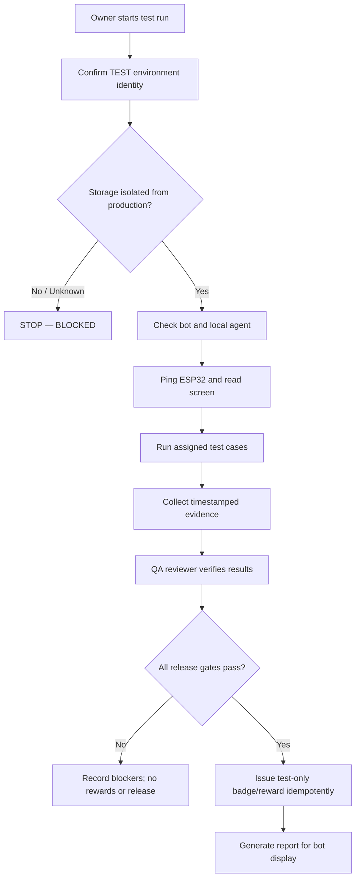

# SLH Pre-Conference Verification Plan — Robot, Bot UX, Test Mode & Tester Rewards

**Date:** 2026-10-19  
**Version:** 0.1 — documentation-only proposal  
**Status:** READY FOR REVIEW; NOT YET EXECUTED OR HARDWARE-VERIFIED  
**Change policy:** freeze-first, read-only discovery, one isolated change per review cycle.

## 1. Purpose

Prepare a repeatable, evidence-based test programme before the conference. The priorities are:

1. Locate and verify the physical ESP32 robot/display and its local agent.
2. Make common bot interactions reliably responsive and recoverable.
3. Add a safe Hebrew/English keyboard-layout correction helper for messages typed with the wrong keyboard layout.
4. Establish a **separate test environment** with synthetic users, balances and reward events.
5. Record test evidence and make a concise report displayable in SLH OS and Telegram.
6. Do not open public trading, deposits, withdrawals, on-chain execution or investment features as part of this test programme.

This document is a plan, not evidence that the code, device, broker, bot, or tests currently work.

## 2. Robot identity and existing path

The repository handoff `SLH_ESP_HANDOFF.md` identifies the device as:

| Item | Repository handoff says | Verification status |
|---|---|---|
| Board | ESP32-D0WD-V3, 4 MB flash | Must be read from the connected device |
| Device ID | `ESP32_14335C6C32C0` | Recorded in handoff; live ping not yet verified |
| Display / touch | ILI9341 320×240 / XPT2046 | Physical response not yet verified in this run |
| Local agent | `AGENT_OSIF2` on Windows | Live availability not yet verified |
| Serial port | `COM9` | May change; enumerate ports before use |
| Control path | Telegram bot → MQTT → local agent / ESP32 | Source-documented; live end-to-end path must be tested |
| Agent log | `C:\\Users\\USER\\slh_agent.log` in handoff | Local path must be checked on the actual PC |

Source: [SLH_ESP_HANDOFF.md](../SLH_ESP_HANDOFF.md).

**Important:** these are repository records, not a live connection check. Do not flash or erase firmware just to identify the robot. Never run `erase_flash` as a diagnostic step.

## 3. Safe discovery sequence

Run the following in the owner's private Telegram chat, one command at a time. Capture the exact output and timestamp.

1. `/agent_status` — checks whether the local agent responds.
2. `/esp_ports` — discovers current serial ports; do not assume COM9.
3. `/esp_chipid` — reads chip information if the agent and board are reachable.
4. `/esp_ping ESP32_14335C6C32C0` — tests device reachability.
5. `/esp_view ESP32_14335C6C32C0` — reads the screen state.
6. `/esp_sync ESP32_14335C6C32C0` — tests a non-financial display sync.
7. `/esp_msg ESP32_14335C6C32C0 TEST-OK-20261019` — displays a harmless test marker; then verify it visually.
8. Check the local agent log and the MQTT response/heartbeat for matching timestamps and device ID.

If a command is unavailable, times out, or returns ambiguous output, record **NOT TESTED / BLOCKED** and stop at that layer. Do not compensate by restarting production or flashing firmware without a separate, reviewed recovery step.

## 4. Hebrew typed with an English keyboard

### User need

The owner often types Hebrew while the keyboard is set to English. Example from the request was intended to say: “מעולה המשך ותתעד כל זאת היטב בפרויקט שאוכל להציג ביישום את זה בכנס”.

### Proposed UX

- Add an explicit helper command, e.g. `/fix_layout <text>`, which returns a **preview** of the converted Hebrew text.
- Optionally offer a “convert previous message” button only if the bot can safely access the immediately preceding user message in the same private chat.
- Never silently rewrite or resend a message. The user must confirm copying/sending the converted result.
- Keep the original text alongside the proposed conversion; allow “use original” and “convert” actions.
- Add an allow-list for private chats and rate limiting; do not log the full text of private messages by default.

### Conversion algorithm and QA

Use a fixed mapping for the standard Israeli Hebrew keyboard layout, not machine translation. Convert each Latin key to the Hebrew character on the same physical key, preserving punctuation and whitespace. Because multiple layouts and capitalization exist, treat the output as a suggestion.

Acceptance targets:
- 20/20 curated Hebrew-on-English examples produce the expected preview.
- 0 silent message edits or sends.
- 100% of conversions require explicit user action before sharing.
- Non-Latin text, URLs, code, and mixed-language text are preserved or clearly flagged; do not blindly convert URLs or code.
- Include an undo/original option.

This feature is **not implemented or verified by this document**. Implement it in a separate PR with unit tests before adding a bot command.

## 5. Test reset and clean test environment

“Reset the system” must mean resetting a **disposable test namespace**, not deleting or rewriting production data.

### Required separation

- Separate test bot or explicit `TEST_MODE=1` enforced server-side.
- Separate test database/storage namespace; no shared production wallets, Ledger, balances, order book, device entitlements or idempotency keys.
- Test-only Credits and synthetic orders must be clearly labelled `TEST`; never represent them as withdrawable, transferable, redeemable, or on-chain value.
- Add a visible environment banner: `TEST ENVIRONMENT — NO REAL VALUE`.
- Ensure production gate values remain unchanged and closed. No test command may mutate production state if a test flag is absent or ambiguous.
- Before a test reset, export a test-only snapshot, show the target environment identifier, and require owner confirmation. Record before/after hashes and the reset request ID.
- A failed or partial reset must fail closed; do not retry a non-idempotent reward operation blindly.

### Reset acceptance gates

1. Prove the target environment is not production.
2. Prove its storage path/database identity is distinct from production.
3. Verify a test reset changes only test records.
4. Verify production row counts, balances, ledgers, orders and gate values remain unchanged.
5. Verify a second reset is idempotent and does not create duplicate grants.
6. Preserve an immutable audit record of who initiated the reset, when, the environment, and the result.

**No reset has been performed.**

## 6. Tester onboarding and rewards

Use tester aliases in shared reports rather than publishing children's full names. The owner may privately map aliases to participants. For younger participants, get parent/guardian permission before collecting personal data or assigning account-based rewards.

| Role | Alias | Test scope | Reward status |
|---|---|---|---|
| Learner / tester | `TESTER-Y1` | Guided learning flow, clarity, button response, error reporting | Not approved or issued |
| Learner / tester | `TESTER-B1` | Guided learning flow, clarity, button response, error reporting | Not approved or issued |
| Other volunteers | `TESTER-###` | Assigned test cases and reproducible bug reports | Not approved or issued |

### Fair reward policy

- Publish the task and reward rule before the test begins.
- Reward verified completion, not clicks, sign-ups alone, or repeated submissions.
- Use test-only points/badges during QA. Real-value rewards require a separately approved policy, age-appropriate consent, fraud/duplicate checks, and a clean accounting path.
- Every reward must have a unique idempotency key, test run ID, task ID, evidence reference and an auditable before/after record.
- The same completed task must never award twice; conflicting replays must return the original result without a second grant.
- No direct balance edits, manual ledger repairs, or production Credits adjustments to compensate for test failures.

## 7. Test coverage and release acceptance

All thresholds below are **proposed acceptance criteria**, not measured results.

| Area | Test | Acceptance target | Current status |
|---|---|---|---|
| Agent | 10 consecutive status checks | 10/10 responses, each within 15 s | NOT TESTED |
| Device | Ping + screen read | Correct device ID; no stale response | NOT TESTED |
| Display | Send and visually verify marker | Correct text in ≤2 s for local display path | NOT TESTED |
| Touch | 20 taps per UI action | ≥19/20 correct actions; no duplicate activation | NOT TESTED |
| Commands | Exercise each read-only command | Correct response or explicit bounded error | NOT TESTED |
| Reconnect | 20 USB/Wi-Fi/MQTT disconnect/reconnect cycles | Recovers within 5 s at P95 without reflashing | NOT TESTED |
| Stability | 2-hour soak, then 24-hour pre-release soak | No crash, unbounded memory growth or corrupted state | NOT TESTED |
| Layout helper | 20 curated test strings | 20/20 expected preview; no silent send | NOT IMPLEMENTED |
| Test isolation | Reset synthetic test namespace | Zero production changes | NOT TESTED |
| Rewards | Repeat the same reward request 3 times | Exactly one grant | NOT TESTED |
| Audit trail | Reconstruct a test from logs | 100% of grants linked to run/task/idempotency key | NOT TESTED |
| Security | Non-owner invokes owner-only action | Denied, no side effects | NOT TESTED |
| Financial safety | Inspect current gates and release audit | All public financial gates remain closed during QA | MUST RECHECK LIVE |

### Short participant test script

1. Open the bot and identify whether it is in TEST or production mode.
2. Run the assigned start/help flow.
3. Tap every visible button once; record any silent or duplicate action.
4. Try the Hebrew keyboard-layout helper using a harmless sentence.
5. Run the assigned robot display task only if the device is online.
6. Submit a bug report with expected result, actual result, timestamp and screenshot/photo if appropriate.
7. Check that the task is marked complete before any test badge is awarded.
8. Repeat one task to verify duplicate protection.
9. Confirm that no real balance, public order, deposit or withdrawal was created.

## 8. Architecture and release workflow

Implementation order:
1. **P0 — Freeze and identify:** read-only inventory of bot, agent, device, environment and gates.
2. **P1 — Robot golden path:** agent online → device ping → display message → visual confirmation → clean log.
3. **P2 — Keyboard helper:** mapping function + unit tests + preview-only bot command.
4. **P3 — Isolated test mode:** storage separation and fail-closed test reset.
5. **P4 — Reward ledger for QA:** test-only idempotent grants and audit.
6. **P5 — Report delivery:** generate Markdown/JSON report and add a read-only bot command such as `/test_report` only after the report source and permissions are tested.
7. **P6 — Release review:** review test results and remaining blockers; no automatic public launch.

## 9. Current financial/audit safety context

The owner's pasted audit output on 2026-10-19 reported:
- Owner Credits ledger audit: BLOCKED; arithmetic errors reported as zero, but two continuity breaks remain unresolved.
- Exchange reserve audit: BLOCKED; 23 findings were reported, including one blocking classification and historical archived test-seed findings.
- The ledger and reserve commands reported read-only behavior; no mutation was made by those commands.

These are **operator-provided snapshots**, not independently re-run evidence in this documentation change. Re-run the read-only audits before any release decision. Do not use a test-mode project to clear, suppress or relabel real production audit findings.

## 10. Evidence packet for the conference

Before presenting the robot or system, assemble:
- commit SHA and deployment identity for the version tested;
- photo/video of the physical device responding to a timestamped test marker;
- command transcript with timestamps and redacted secrets;
- local agent and MQTT health evidence;
- test matrix with PASS / FAIL / BLOCKED / NOT TESTED and evidence links;
- test environment identity and proof of production isolation;
- duplicate-reward test output;
- list of unresolved blockers and owner-approved next steps.

A file in the repository does not prove the command works in the live bot. A successful compile does not prove hardware connectivity. A successful device ping does not prove that the display, touch, MCP or reward path works end-to-end.

## 11. Status at document creation

| Deliverable | Status |
|---|---|
| Identify the likely robot and documented control path | SOURCE FOUND; live state unverified |
| Read-only initial plan | DOCUMENTED |
| Keyboard-layout helper | PROPOSED; not implemented |
| Isolated reset | PROPOSED; not executed |
| Tester reward workflow | PROPOSED; no rewards issued |
| Bot-visible test report command | PROPOSED; not verified or implemented |
| Full pre-conference validation | NOT STARTED / NOT VERIFIED |

**Release rule:** do not call the system “ready for the conference” until the golden path passes on the real device, test isolation is proven, rewards are idempotent, and every remaining failure is disclosed.

